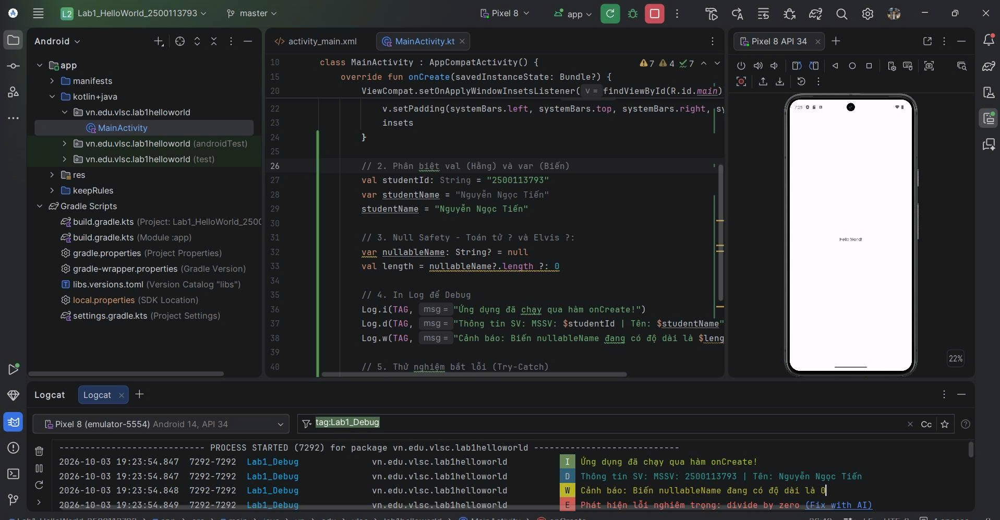

# Lab 3a — Ứng dụng hiển thị danh sách thẻ động với RecyclerView (ListAdapter + DiffUtil)

## 👤 Thông tin sinh viên
- **Họ và tên:** Đỗ Minh Khoa
- **Mã số sinh viên (MSSV):** 2500114713
- **Lớp / Môn học:** Phát triển Ứng dụng Di động Tích hợp AI — Buổi 03

---

## 📱 Giới thiệu bài Lab
Bài thực hành **Lab 3a** xây dựng ứng dụng Android hiển thị danh sách 10 sinh viên dưới dạng thẻ `MaterialCardView` bo góc tối ưu bằng `RecyclerView`, `ListAdapter`, `DiffUtil` và `ViewBinding`.

### Các công nghệ trọng tâm:
- **RecyclerView 1.4**: Hiển thị danh sách động tối ưu bộ nhớ qua cơ chế View Recycling.
- **ListAdapter + DiffUtil**: Quản lý và tự động so sánh dữ liệu danh sách ở luồng nền, tối ưu hóa hoạt động cập nhật view và tạo animation mượt mà.
- **Material3 CardView**: Thẻ hiển thị chuẩn Material Design 3 với hiệu ứng gợn sóng (ripple), bo góc và độ nổi (elevation).
- **ViewBinding**: Truy cập view an toàn theo kiểu dữ liệu (type-safe), thay thế cho `findViewById`.
- **Edge-to-Edge**: Tự động xử lý WindowInsets giúp giao diện tràn màn hình hiện đại.

---

## 🖼️ Minh chứng kết quả thực hiện

*Hình ảnh minh chứng: Giao diện ứng dụng chạy thành công hiển thị danh sách sinh viên chuẩn MaterialCardView trên Android Studio.*

---

## 🛠️ Hướng dẫn cài đặt và chạy ứng dụng

1. **Yêu cầu hệ thống:**
   - Android Studio Quail (2026.1.x) hoặc mới hơn.
   - JDK 11+, Kotlin 2.x, Android SDK API Level 35/37.
   - Máy ảo Emulator (hoặc thiết bị thật) chạy Android 7.0 (API 24) trở lên.

2. **Cách chạy ứng dụng:**
   - Mở dự án trong Android Studio.
   - Thực hiện **Gradle Sync** (`File -> Sync Project with Gradle Files`).
   - Chọn thiết bị chạy (Emulator/Physical Device) và bấm **Run** (`Shift + F10`).

---

## 🤖 Sử dụng AI có trách nhiệm (AI Usage Statement)
- **Công cụ AI sử dụng:** Gemini in Android Studio.
- **Mục đích:**
  - Hỗ trợ giải thích và rà soát code theo chuẩn Kotlin.
  - Hỗ trợ cấu hình Gradle và khôi phục cấu trúc dự án.
  - Rà soát layout XML theo chuẩn thiết kế Material 3.
- **Cam kết:** Sinh viên tự hiểu rõ và nắm vững toàn bộ kiến thức, mã nguồn triển khai trong bài Lab.
